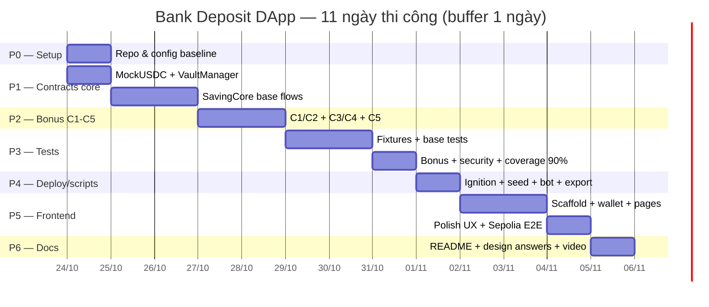

# 🚀 EXECUTION PLAN — Bank Deposit DApp (AT190234)

> **Loại tài liệu:** Kế hoạch triển khai (task-level) — chuyển `implementation_plan.md` (thiết kế) thành các bước thi công có thứ tự, có cổng kiểm soát (quality gate) và tiêu chí hoàn thành (DoD).
> **Ngày lập:** 2026-10-23 · **Phiên bản:** 1.0
> **Nguồn:** `implementation_plan.md`, `extracted_assignment.txt`, `.agent/skills/architecture-designer`, `.agent/skills/ui-ux-pro-max`
> **Biến thể cá nhân:** A = 4 (cuối MSSV), B = 3 (kề cuối) → grace **3 ngày**, APR **300 bps**, penalty **450 bps**, tenor **180 ngày**
>
> **📊 Tiến độ:** ✅ **P0** · ✅ **P1** (35/35 test, coverage 100%) · ✅ **P2** (121/121 test, SavingCore coverage 97.53%) · ⬜ P3+ · cập nhật 2026-10-23

---

## 0. Cách dùng tài liệu

| Ký hiệu | Ý nghĩa |
|---|---|
| ⬜ | Chưa làm |
| 🔄 | Đang làm |
| ✅ | Xong + đã qua DoD |
| ⛔ | Bị chặn (ghi lý do + người gỡ) |

**Nguyên tắc thi công**

1. Làm **tuần tự theo phase**. Không mở phase sau khi phase trước chưa xanh gate.
2. Mỗi task = 1 commit (hoặc 1 cụm commit nhỏ), message theo Conventional Commits.
3. Mỗi phase kết thúc bằng: `compile` → `test` → `coverage` → cập nhật checklist trong file này.
4. **Base flows (Section 3 của đề) luôn được ưu tiên hơn C1–C5.** Bonus chỉ làm khi 100% test base xanh.
5. Khi phát hiện mâu thuẫn thiết kế → ghi vào mục 4 (Decision Log) rồi mới code.

---

## 1. Mục tiêu & phạm vi

### 1.1 Sản phẩm bàn giao

| # | Deliverable | Đường dẫn đích | Trạng thái |
|---|---|---|---|
| D1 | 3 smart contract + interfaces + mocks | `ac-hardhat-template-v2/contracts/**` | 🔄 (3/3 hiện diện: MockUSDC, VaultManager, SavingCore base; còn bổ sung bonus C1–C5 ở P3) |
| D2 | Test suite ≥ 90% coverage, ≥ 76 test case | `ac-hardhat-template-v2/test/**` | 🔄 (121 test, coverage tổng 98.08% · đã vượt ≥90% từ P2) |
| D3 | Ignition module + scripts (seed, bot, export ABI, time-travel) | `ac-hardhat-template-v2/ignition/modules/`, `scripts/` | ⬜ |
| D4 | Frontend React + Vite + ethers v6 + MetaMask | `frontend/**` | ⬜ |
| D5 | README (variant, how-to-run, architecture, **Design Answers 7 câu**, C1–C5) | `README.md` (repo root) | ⬜ |
| D6 | Video demo 3–5 phút | link YouTube/Drive trong README | ⬜ |

### 1.2 Tiêu chí thành công (map theo thang điểm của đề)

| Tiêu chí | Điểm | Bằng chứng phải có |
|---|---:|---|
| Interest & penalty math đúng, dùng số biến thể | 20 | Test exact-value: 1.000 USDC / 180d / 300 bps = **14.794520 USDC**; penalty 450 bps trên 1.000 USDC = **45 USDC** |
| Snapshot APR/penalty bất biến | 15 | Test: admin `updatePlan` sau khi mở → deposit cũ không đổi |
| Auto-renew: APR lock + grace 3 ngày | 15 | Test boundary trước/đúng/sau `maturityAt + 3 days` |
| Vault & pause/unpause | 10 | Test fund/withdraw/insolvent, pause blocks, C5 emergency |
| Coverage > 90% | 15 | `npx hardhat test --coverage` + ảnh/report |
| Design Answers + oral defense | 10 | README 7 câu, mỗi câu có code pointer |
| Frontend demo | 10 | 5 màn hình chạy được với MetaMask |
| Code quality + events | 5 | NatSpec, 5 event bắt buộc, custom errors nhất quán |
| Bonus C1–C5 | +10 | Mỗi C có code + test riêng + note problem/solution/trade-off |

### 1.3 Ngoài phạm vi (không làm)

- Upgradeable proxy (không cần cho bài học thuật).
- Indexer/Subgraph, backend API.
- Multi-chain deploy, mainnet.
- Fiat payment, KYC.

---

## 2. Hiện trạng repo (audit 2026-10-23)

| Hạng mục | Hiện trạng | Việc cần làm |
|---|---|---|
| `contracts/`, `test/`, `scripts/`, `ignition/modules/` | **Rỗng hoàn toàn** (template mới) | Tạo mới toàn bộ theo P1–P5 |
| `package.json` (template) | Có script trỏ tới `Counter.ts`, `MyToken.ts`… **không tồn tại** | Viết lại scripts (T0.3) |
| `package.json` (root `Bank/`) | Placeholder `"test": "exit 1"`, type commonjs | Xoá hoặc chuyển thành proxy scripts (T0.1) |
| `hardhat.config.ts` | Solidity 0.8.28, optimizer 1000, mạng sepolia/ethereum/bscTestnet — **thiếu `localhost`** | Thêm network `localhost` (T0.2) |
| Deps | Hardhat 3.19, ethers 6.17, OZ 5.6.1, TS 7.0.2, network-helpers, chai-matchers | Đủ dùng, không cần cài thêm |
| Coverage | Hardhat 3 dùng cờ `--coverage` (không có task `hardhat coverage`) | Sửa lệnh trong plan gốc (xem 4.11) |
| `ignition/deployments/chain-11155111` | Chứa deploy cũ của MyToken/MyNFT/MyMintableToken | Không tái sử dụng; đặt deployment ID riêng cho BankDeposit |
| `.env` | Có 6 biến (theo `.env_example`) | Bổ sung/kiểm tra key trước khi deploy Sepolia |
| Vị trí repo | Nằm trong **OneDrive** | Rủi ro lock file `node_modules` → xem Risk R1 |

---

## 3. Cấu trúc thư mục đích

```text
Bank/
├── README.md                      # D5 — tài liệu nộp bài
├── implementation_plan.md         # (đã có) thiết kế
├── EXECUTION_PLAN.md              # tài liệu này
├── frontend/                      # D4
│   ├── .env.example
│   ├── index.html
│   ├── package.json
│   ├── vite.config.ts
│   └── src/
│       ├── main.tsx / App.tsx
│       ├── config/{addresses.json, contracts.ts, chain.ts}
│       ├── abis/{MockUSDC,VaultManager,SavingCore}.json   # generated
│       ├── providers/{WalletProvider.tsx, ContractsProvider.tsx, ToastProvider.tsx}
│       ├── hooks/{usePlans,useDeposits,useDeposit,useTx,useCountdown}.ts
│       ├── components/{Layout,Navbar,WalletButton,NetworkGuard,PlanCard,
│       │               DepositCard,Countdown,StatusBadge,AmountInput,
│       │               TxButton,Toast,EmptyState,Skeleton}.tsx
│       ├── pages/{Dashboard,MyDeposits,OpenDeposit,DepositDetail,Admin}.tsx
│       ├── lib/{format.ts,errors.ts,constants.ts}
│       └── styles/index.css
└── ac-hardhat-template-v2/
    ├── hardhat.config.ts          # + localhost network
    ├── package.json               # scripts mới
    ├── contracts/
    │   ├── MockUSDC.sol
    │   ├── VaultManager.sol
    │   ├── SavingCore.sol
    │   ├── interfaces/IVaultManager.sol
    │   ├── interfaces/ISavingCore.sol
    │   └── mocks/{ReentrantToken.sol, ReentrancyAttacker.sol}   # test-only
    ├── test/
    │   ├── helpers/setup.ts
    │   ├── MockUSDC.test.ts
    │   ├── VaultManager.test.ts
    │   ├── SavingCore.base.test.ts
    │   ├── SavingCore.bonus.test.ts
    │   └── Security.test.ts
    ├── ignition/modules/BankDeposit.ts
    └── scripts/
        ├── seed.ts                # tạo plans + fund vault + mint demo
        ├── bot.ts                 # auto-renew bot
        ├── exportFrontend.ts      # ABI + addresses → frontend/src
        ├── timeTravel.ts          # evm_increaseTime cho demo local
        └── interact.ts            # smoke test CLI
```

---

## 4. Decision Log — chốt trước khi code

> Đây là các điểm `implementation_plan.md` còn mơ hồ hoặc có mâu thuẫn. Chốt xong mới code, và **phải ghi vào README** (mục Design Answers / Challenges) để bảo vệ khi oral.

| ID | Vấn đề | Quyết định | Lý do / Trade-off |
|---|---|---|---|
| **D1** | NFT sau khi tất toán: giữ hay burn? | **Burn** NFT khi `withdrawAtMaturity`, `earlyWithdraw`, `emergencyWithdraw`, và khi renew (cả manual + auto). `DepositInfo` vẫn giữ để tra cứu lịch sử. | Tránh bán "certificate đã chết" cho người khác (scam). Đổi lại: không còn `ownerOf` để tra cứu → frontend đọc từ event/struct. Ghi rõ trong README Q1. |
| **D2** | Ai là nguồn sự thật của pause? | **VaultManager** giữ trạng thái (`Pausable` + `pausedAt`). `SavingCore` đọc `vault.isPaused()` qua modifier `whenNotPaused`. `payInterest/receivePenalty/owe*` **không** bị pause (nếu chặn sẽ làm C1/C5 bế tắc). | Một nguồn duy nhất, tránh 2 contract lệch trạng thái. |
| **D3** | Rule 6 ("pause → cấm mọi withdrawal") vs C5 (emergency rút khi pause lâu) | Pause chặn `openDeposit`, `topUp`, `withdraw`, `renew`, `autoRenew`, `partial`, `claim`. **Ngoại lệ duy nhất:** `emergencyWithdraw` khi `paused ≥ 7 ngày`. | C5 là "own idea" hợp lệ; ghi rõ đây là override có chủ đích, có test boundary. |
| **D4** | C4 top-up: tính lãi công bằng thế nào? | Dùng **`principalSeconds`** (tổng `principal × số giây còn lại`). Top-up: `principalSeconds += amount × (maturityAt - now)`. Lãi cuối kỳ = `principalSeconds × aprBps / (365 days × 10_000)`. | Công bằng cho tiền mới (chỉ ăn lãi phần thời gian còn lại), không đổi ngày đáo hạn, không cần mảng tranche. Đổi lại: thêm 1 storage slot + phải cập nhật ở C3. |
| **D5** | C3 partial early: lãi phần còn lại? | Trừ `principalSeconds -= amount × (maturityAt - now)`, trừ `principal`, penalty chỉ trên `amount`, lãi = 0 cho phần rút. | Phần còn lại tiếp tục tích lũy đúng theo thời gian còn lại. |
| **D6** | C1: vault không đủ trả lãi | Trả principal ngay + `pendingInterest[owner] += interest` + `InterestDeferred`. **Không** giảm `totalOwedInterest`. `claimPendingInterest()` trả khi vault đủ. | Principal luôn an toàn; lãi không mất, chỉ chậm. Claim revert nếu vault chưa đủ (đơn giản, tránh chia nhỏ lẻ). |
| **D7** | C2: `totalOwedInterest` cập nhật ở đâu? | Tăng ở `openDeposit` + `topUpDeposit`; giảm ở `withdrawAtMaturity`, `earlyWithdraw`, `partialEarlyWithdraw`, `renew`, `autoRenew`, `emergencyWithdraw`, `claimPendingInterest`. | Invariant test: `totalOwedInterest == Σ previewInterest(deposit Active/owed)` sau mỗi flow. Xem T-A10. |
| **D8** | Boundary thời gian | `earlyWithdraw`: `now < maturityAt`. `withdrawAtMaturity`/`renewDeposit`: `now >= maturityAt` (renew **không** có upper bound). `autoRenewDeposit`: `now >= maturityAt + 3 days`. | Đúng đề ("on or after maturity"). Tại đúng giây cuối grace: manual renew vẫn được nếu bot chưa gọi → ai gọi trước thắng; ghi rõ trong README Q5. |
| **D9** | Dust làm tròn | Interest **round down**, dust ở lại **vault**. | Vault trả đúng `interest` tính ra, phần lẻ < 1 unit không rời vault. Test: principal 1 unit → interest 0, không revert. |
| **D10** | Overflow công thức | Giữ thứ tự nhân trước chia; thêm `MAX_PRINCIPAL = 1e15 * 1e6` (1 tỷ USDC) check ở `openDeposit/topUp` để chặn overflow phi thực tế. | uint256 đủ cho giới hạn này; vẫn có test biên. |
| **D11** | Lệnh coverage | Dùng `npx hardhat test --coverage` (Hardhat 3 built-in). `npx hardhat coverage` **không tồn tại** trong HH3 → sửa lại so với plan gốc. | Đã xác minh bằng `npx hardhat --help` trên template. |
| **D12** | Frontend lấy ABI/address | Script `exportFrontend.ts` đọc `artifacts/` + `ignition/deployments/.../deployed_addresses.json` → sinh `frontend/src/abis/*.json` + `addresses.json`. | Tránh copy tay ABI lệch sau mỗi lần sửa contract. |
| **D13** | Quyền rút theo NFT (Q1) | Quyền thuộc **chủ sở hữu hiện tại** (`ownerOf(depositId) == msg.sender`), không lưu `originalOwner`. | Certificate chuyển nhượng được → quyền đi theo NFT. Rủi ro: người mua cần tin tưởng; ghi rõ trong README Q1. |
| **D14** | Trạng thái khi emergency | Giữ enum 4 giá trị theo đề; emergency dùng `status = Withdrawn` + event riêng `EmergencyWithdrawn`. | Không phá vỡ enum mà đề yêu cầu; vẫn phân biệt được qua event. |

---

## 5. Lộ trình tổng quan



| Milestone | Ngày | Kết quả phải có | Gate |
|---|---|---|---|
| **M0** Setup | 24/10 | Repo sạch, scripts/config đúng, commit đầu tiên | `npm run compile` pass (chưa có contract cũng OK) |
| **M1** Contracts core | 24–26/10 | 3 contract base compile, không warning logic | `npm test` có test đầu tiên pass |
| **M2** Bonus | 27–28/10 | C1–C5 hoạt động, có test riêng | Toàn bộ test base vẫn xanh |
| **M3** Test + coverage | 29–31/10 | ≥ 76 test, coverage ≥ 90% | `npx hardhat test --coverage` |
| **M4** Deploy/scripts | 01/11 | Deploy local + Sepolia, bot + seed chạy | `seed` tạo plan, `bot` tự renew |
| **M5** Frontend | 02–04/11 | 5 page, MetaMask, E2E local | Checklist UX + build pass |
| **M6** Docs | 05/11 | README đầy đủ + video | Đọc README là chạy lại được từ đầu |

---

## 6. Chi tiết task

### P0 — Setup & baseline (0,5–1 ngày)

| ID | Task | File / lệnh | DoD | Est |
|---|---|---|---|---|
| T0.1 | Chốt layout: giữ `ac-hardhat-template-v2/` là project chính; xử lý `package.json` root (xoá hoặc thêm script proxy `npm --prefix ac-hardhat-template-v2 ...`) | `Bank/package.json` | Chạy `npm test` ở root không còn lỗi giả; README ghi rõ phải `cd ac-hardhat-template-v2` | 20' |
| T0.2 | Thêm network `localhost` (http://127.0.0.1:8545) vào config | `hardhat.config.ts` | `npx hardhat run scripts/x.ts --network localhost` kết nối được khi `npx hardhat node` đang chạy | 15' |
| T0.3 | Viết lại `package.json` scripts: `compile`, `test`, `test:coverage`, `test:gas`, `node`, `deploy:local`, `deploy:sepolia`, `seed:local`, `seed:sepolia`, `bot:local`, `bot:sepolia`, `export:frontend`, `demo:travel` | `ac-hardhat-template-v2/package.json` | Không còn script trỏ file không tồn tại | 20' |
| T0.4 | Kiểm tra `.env` / `.env_example`: `TESTNET_PRIVATE_KEY`, `SEPOLIA_RPC_URL`, `ETHERSCAN_API_KEY` | `.env_example` | `.env` không bị commit; `.gitignore` đã có `.env` | 10' |
| T0.5 | Tạo skeleton thư mục `contracts/interfaces`, `contracts/mocks`, `test/helpers` | — | `git status` sạch sau commit | 10' |
| T0.6 | **Git init** (repo hiện chưa có `.git`), branch `main` + `feat/contracts`, `.gitattributes` (nếu cần) | `.git/` | `git log` có commit `chore: init project` | 15' |
| T0.7 | Xử lý rủi ro OneDrive: chuyển repo ra `C:\dev\Bank` **hoặc** exclude `node_modules` khỏi sync | — | `npx hardhat compile` < 60s, không lỗi lock file | 20' |
| T0.8 | Smoke test hạ tầng: viết 1 test tạm cho contract rỗng? **Không** — thay bằng chạy `npx hardhat compile` + `npx hardhat test --coverage` sau T1.1 | — | Lệnh coverage chạy được (xác nhận cú pháp HH3) | 10' |

**Gate P0:** `npx hardhat compile` pass; git sạch; scripts không lỗi; đã xác nhận lệnh coverage.

---

### P1 — Contracts core (2,5 ngày)

#### P1.1 `MockUSDC.sol`

| ID | Task | DoD |
|---|---|---|
| T1.1 | Viết `MockUSDC` kế thừa `ERC20` (OZ 5.6.1), `decimals() = 6`, `mint(address,uint256)` public, NatSpec đầy đủ | Compile sạch; `decimals()` trả 6 |
| T1.2 | Test 5 case: name/symbol, decimals, mint public, transfer, approve+transferFrom | `test/MockUSDC.test.ts` xanh |

#### P1.2 `interfaces/IVaultManager.sol`

| ID | Task | DoD |
|---|---|---|
| T1.3 | Interface tối thiểu cho SavingCore dùng: `isPaused()`, `pausedAt()`, `payInterest()`, `receivePenalty()`, `increaseOwedInterest()`, `decreaseOwedInterest()`, `getVaultBalance()` | Không import vòng; `SavingCore` chỉ phụ thuộc interface |

#### P1.3 `VaultManager.sol`

| ID | Task | Chi tiết | DoD |
|---|---|---|---|
| T1.4 | Khung contract: `Ownable`, `Pausable`, `SafeERC20`, immutable `token`, `feeReceiver`, `savingCore` | Constructor `Ownable(msg.sender)` (OZ v5) | Compile |
| T1.5 | Admin: `setSavingCore`, `setFeeReceiver`, `fundVault`, `withdrawVault` (C2 guard), `pause/unpause` + `pausedAt` | `withdrawVault` chặn `bal - amount < totalOwedInterest` | Revert đúng |
| T1.6 | Callable by SavingCore: `payInterest`, `receivePenalty`, `increaseOwedInterest`, `decreaseOwedInterest` + modifier `onlySavingCore` | `payInterest` **không** `whenNotPaused` (D2) | Test phân quyền |
| T1.7 | Views: `getVaultBalance`, `getAvailableBalance`, `isPaused`; events đầy đủ | Event: Funded/Withdrawn/InterestPaid/PenaltyForwarded/FeeReceiverUpdated/SavingCoreUpdated | — |
| T1.8 | Test 15 case theo plan gốc + 2 case biên C2 (rút đúng bằng ngưỡng; vượt 1 unit revert) | `test/VaultManager.test.ts` | Xanh |

**Gate P1:** `MockUSDC` + `VaultManager` compile; 22 test xanh; không warning Solidity.

---

### P2 — `SavingCore.sol` base flows (2 ngày)

#### P2.1 Khung & dữ liệu

| ID | Task | Chi tiết | DoD |
|---|---|---|---|
| T2.1 | Khai báo contract `SavingCore is ERC721, ERC721Enumerable, Ownable, ReentrancyGuard` | OZ v5 bắt buộc override `_update`, `_increaseBalance`, `supportsInterface` | Compile |
| T2.2 | Structs & enum | `Plan`, `DepositInfo` (thêm `principalSeconds`), `DepositStatus` 4 giá trị | — |
| T2.3 | Constants | `GRACE_PERIOD = 3 days`, `BPS_DIVISOR = 10_000`, `YEAR_SECONDS = 365 days`, `EMERGENCY_DELAY = 7 days`, `MAX_PRINCIPAL` | Khớp biến thể AT190234 |
| T2.4 | Storage | `plans`, `deposits`, `_nextPlanId`, `_nextDepositId`, `pendingInterest`, `vault` (immutable IVaultManager), `token` (immutable) | — |
| T2.5 | Modifier & helper | `onlyOwner`, `whenNotPaused` (đọc vault), `onlyDepositOwner(id)`, `_calcInterest(principalSeconds, aprBps)`, `previewInterest(id)`, `previewPenalty(amount, bps)` | Multiply-before-divide |

#### P2.2 Plan CRUD (admin)

| ID | Task | DoD |
|---|---|---|
| T2.6 | `createPlan(tenorDays, aprBps, minDeposit, maxDeposit, penaltyBps)` validate: tenor > 0, 0 < aprBps ≤ 10_000, penalty ≤ 10_000, min ≤ max (nếu max > 0) | Emit `PlanCreated`; test APR = 0 revert |
| T2.7 | `updatePlan(planId, newAprBps)` — **chỉ ảnh hưởng deposit mới**; `enablePlan` / `disablePlan` | Emit `PlanUpdated`; snapshot test |
| T2.8 | Views cho frontend: `planCount()`, `getPlan(id)`, `getDeposit(id)`, `nextDepositId()`, `isPlanEnabled(id)` | ABI đủ cho FE, không cần đọc storage |

#### P2.3 Open deposit

| ID | Task | Chi tiết | DoD |
|---|---|---|---|
| T2.9 | `openDeposit(planId, amount)` | Checks: plan enabled, amount ≥ min, ≤ max (nếu max > 0), ≤ MAX_PRINCIPAL. Effects: tạo deposit, `principalSeconds = amount × tenorDays × 86400`, status Active, `maturityAt = now + tenorDays × 86400`, snapshot APR/penalty. Interactions: `safeTransferFrom` **trước**, `_safeMint` sau (CEI + nonReentrant) | Emit `DepositOpened`; NFT mint; token chuyển vào contract |
| T2.10 | Gọi `vault.increaseOwedInterest(interest)` ngay sau khi tạo deposit (C2) | Owed tăng đúng bằng `previewInterest` | Test T-A (C2) |

#### P2.4 Withdraw at maturity

| ID | Task | Chi tiết | DoD |
|---|---|---|---|
| T2.11 | `withdrawAtMaturity(id)` | `require(now >= maturityAt)`, `require(status == Active)`, `require(ownerOf == msg.sender)`; set `status = Withdrawn` **trước** external call; burn NFT; trả principal từ SavingCore; xử lý interest theo C1 (P3) | Emit `Withdrawn(..., isEarly=false)`; double-withdraw revert |
| T2.12 | `previewMaturity(id)` view → `(principal, interest, penaltyIfEarly, maturityAt, status)` cho FE | FE không phải tự tính | — |

#### P2.5 Early withdraw

| ID | Task | Chi tiết | DoD |
|---|---|---|---|
| T2.13 | `earlyWithdraw(id)` | `require(now < maturityAt)`; `penalty = principal × penaltyBpsAtOpen / 10_000`; set status; burn; trả `principal - penalty`; chuyển penalty sang vault → `receivePenalty` → feeReceiver; `decreaseOwedInterest(interest)` | Emit `Withdrawn(..., isEarly=true)` + `InterestDeferred`? **Không** — early không có lãi |
| T2.14 | Test penalty exact 45 USDC, user nhận 955 USDC, feeReceiver +45 | — |

#### P2.6 Manual renew

| ID | Task | Chi tiết | DoD |
|---|---|---|---|
| T2.15 | `renewDeposit(id, newPlanId)` | `require(now >= maturityAt)`, `require(status == Active)`, plan mới **phải enabled**; interest = preview; newPrincipal = principal + interest; set status `ManualRenewed`; burn NFT cũ; tạo deposit mới với APR của plan mới + tenor của plan mới; mint NFT mới; update owed: `oldOwed` giảm, `newOwed` tăng | Emit `Renewed(oldId, newId, newPrincipal, newPlanId)` |

#### P2.7 Auto renew

| ID | Task | Chi tiết | DoD |
|---|---|---|---|
| T2.16 | `autoRenewDeposit(id)` — **ai cũng gọi được** (bot hoặc user) | `require(now >= maturityAt + GRACE_PERIOD)`, `require(status == Active)`; APR **giữ nguyên `aprBpsAtOpen`**, tenor giữ nguyên `tenorDays`; newPrincipal = principal + interest; status `AutoRenewed`; burn cũ; mint mới; update owed | Emit `Renewed`; test APR lock |

**Gate P2:** 5 flow base chạy được trên test thủ công; tất cả event bắt buộc có mặt; `npx hardhat compile` không warning.

---

### P3 — Creative Challenges C1–C5 (2 ngày)

| ID | Challenge | Task chi tiết | Test bắt buộc | Est |
|---|---|---|---|---|
| T3.1 | **C1** Principal always safe | Trong `withdrawAtMaturity`: nếu `vault.getVaultBalance() < interest` → trả principal, `pendingInterest[msg.sender] += interest`, emit `InterestDeferred`, **không** `decreaseOwedInterest` | T-A16, T-A17 | 3h |
| T3.2 | **C1** claim | `claimPendingInterest()`: `require(pending > 0)`, `require(vault đủ)`, zero trước khi transfer, gọi `vault.payInterest`, `decreaseOwedInterest`, emit `PendingInterestClaimed` | claim OK, claim 2 lần revert, claim khi vault thiếu revert | 1h |
| T3.3 | **C2** Solvency guard | Hoàn thiện accounting ở mọi nhánh chuyển trạng thái (D7); thêm view `totalOwedInterest()`; kiểm tra invariant bằng helper test | 5 nhánh update owed + invariant | 2h |
| T3.4 | **C3** Partial early | `partialEarlyWithdraw(id, amount)`: `0 < amount < principal`, `now < maturityAt`; penalty = amount × bps; trả `amount - penalty`; penalty → feeReceiver; `principal -= amount`; `principalSeconds -= amount × (maturityAt - now)`; `decreaseOwedInterest(deltaInterest)`; **không** burn NFT, giữ Active | amount == principal revert; phần còn lại vẫn sinh lãi đúng | 3h |
| T3.5 | **C4** Top-up | `topUpDeposit(id, amount)`: Active, `now < maturityAt`, amount > 0, amount + principal ≤ MAX_PRINCIPAL; `principalSeconds += amount × (maturityAt - now)`; `principal += amount`; `increaseOwedInterest(delta)`; transfer token vào; emit `DepositToppedUp` | interest theo weighted; owed tăng đúng delta; top-up khi paused revert | 3h |
| T3.6 | **C5** Emergency withdraw | `emergencyWithdraw(id)`: `require(vault.isPaused())`, `require(block.timestamp >= vault.pausedAt() + 7 days)`, Active, owner; trả **principal only**, không lãi, không penalty; status `Withdrawn`; burn; `decreaseOwedInterest`; emit `EmergencyWithdrawn` | đúng 7 ngày pass; 7 ngày - 1s revert; không pause revert; paused 1 ngày revert | 2h |
| T3.7 | Views bổ sung | `pendingInterestOf(address)`, `canAutoRenew(id)`, `isMatured(id)`, `getUserDepositIds(address)` (dùng ERC721Enumerable) | FE dùng được | 1h |
| T3.8 | NatSpec + error catalog | Custom errors: `PlanNotEnabled`, `AmountOutOfRange`, `NotDepositOwner`, `DepositNotActive`, `TooEarly`, `TooLate`, `VaultInsolvent`, `NothingPending`, `ZeroAmount`… | Mỗi error có comment | 1h |

**Gate P3:** Toàn bộ 5 base flow + 5 bonus flow có test riêng; `totalOwedInterest` invariant xanh; không có hàm nào thiếu test happy path.

> ⚠️ **Thứ tự ưu tiên nếu hết thời gian:** C1 + C2 (dễ bảo vệ, ăn điểm thiết kế) → C4 → C5 → C3. Ghi rõ trong README nếu bỏ.

---

### P4 — Test suite & coverage (3 ngày)

#### P4.1 Hạ tầng test

| ID | Task | Chi tiết | DoD |
|---|---|---|---|
| T4.1 | `test/helpers/setup.ts` dùng **Hardhat 3 API** | `const connection = await network.create(); export const { ethers, networkHelpers } = connection;` (không dùng `hre.ethers` kiểu HH2) | Import chạy |
| T4.2 | `deployFixture()`: deploy 3 contract, link vault↔core, mint USDC cho user1/user2/owner, fund vault 500k, tạo 1 plan mặc định (180d/300bps/450bps) | Trả về đủ signer + contract + helper `USDC(n)` | `loadFixture(deployFixture)` ổn định |
| T4.3 | Helpers: `openDeposit(user, amount, planId)`, `timeToMaturity()`, `timeToGraceEnd()`, `expectOwedInvariant()` | Dùng `networkHelpers.time.increase()` | Tái sử dụng |
| T4.4 | Quy ước test: mỗi `describe` = 1 function; assert cả **event** + **balance delta** + **status** | — | Review chéo |

#### P4.2 Bộ test (76 case)

| File | Nhóm | Số case | Ghi chú |
|---|---|---:|---|
| `MockUSDC.test.ts` | token | 5 | |
| `VaultManager.test.ts` | admin/vault/C2 | 17 | +2 case biên C2 |
| `SavingCore.base.test.ts` | plans, open, withdraw, early, renew, auto, pause, edge | 45 | 40 case gốc + 5 case bổ sung |
| `SavingCore.bonus.test.ts` | C1–C5 | 12 | |
| `Security.test.ts` | reentrancy, double-withdraw, fake token, transfer NFT, dust | 8 | |
| **Tổng** | | **87** | Mục tiêu ≥ 76, coverage ≥ 90% |

<details>
<summary><b>Danh sách case bổ sung ngoài 55 case của plan gốc</b></summary>

| ID | Case | Kỳ vọng |
|---|---|---|
| T-A1 | Withdraw xong → `ownerOf(id)` revert | NFT đã burn |
| T-A2 | Transfer NFT trước maturity → owner mới withdraw được, owner cũ revert | Quyền theo NFT (D13) |
| T-A3 | Không thể transfer NFT đã tất toán | Đã burn |
| T-A4 | Pause chặn `openDeposit` + `topUpDeposit` | revert `EnforcedPause`/custom |
| T-A5 | Emergency sau 7 ngày pause trả đúng principal, không lãi | balance delta chính xác |
| T-A6 | Emergency đúng biên `pausedAt + 7 days` | pass |
| T-A7 | Manual renew sau grace (bot chưa gọi) vẫn được | pass |
| T-A8 | Auto-renew trên plan đã disable | vẫn pass, APR lock |
| T-A9 | Auto-renew sau khi NFT đã transfer | NFT mới mint cho owner hiện tại |
| T-A10 | Invariant owed sau mỗi flow | `Σ previewInterest(Active) == totalOwedInterest` |
| T-A11 | `withdrawVault` đúng bằng phần dư | pass; +1 unit revert |
| T-A12 | Top-up → partial → maturity | lãi = weighted chính xác |
| T-A13 | Top-up làm owed tăng đúng delta | pass |
| T-A14 | Partial penalty exact trên amount | pass |
| T-A15 | Partial `amount == principal` | revert (dùng `earlyWithdraw`) |
| T-A16 | Claim sau khi vault được fund lại | nhận đủ, pending = 0, owed giảm |
| T-A17 | Vault = 0 tại maturity | principal vẫn trả đủ |
| T-A18 | Token độc (reentrancy) | guard chặn, không rút 2 lần |
| T-A19 | Principal 1 unit | interest = 0, không revert, dust ở vault |
| T-A20 | 2 user độc lập | số dư & owed không lẫn |
| T-A21 | `previewInterest` == payout thực tế cho 5 tenor khác nhau | khớp 100% |
| T-A22 | Interest overflow guard với principal > MAX_PRINCIPAL | revert |

</details>

#### P4.3 Coverage & gas

| ID | Task | Lệnh | DoD |
|---|---|---|---|
| T4.5 | Chạy coverage | `npx hardhat test --coverage` | Report sinh ra; ≥ 90% line & branch cho 3 contract chính |
| T4.6 | Nếu < 90%: liệt kê nhánh thiếu, viết test bổ sung | — | Không dùng `istanbul ignore` cho logic nghiệp vụ |
| T4.7 | Gas snapshot | `npx hardhat test --gas-stats` | Lưu `gas-report.txt` (không bắt buộc nộp nhưng tốt để tối ưu) |
| T4.8 | Test chạy ổn định 3 lần liên tiếp (không flaky do timestamp) | `npm test` ×3 | Không test nào phụ thuộc block timestamp tuyệt đối |

**Gate P4:** 87/87 pass, coverage ≥ 90%, không flaky, `npm test` < 60s.

---

### P5 — Deploy, scripts & bot (1 ngày)

| ID | Task | Chi tiết | DoD |
|---|---|---|---|
| T5.1 | `ignition/modules/BankDeposit.ts` | `m.getParameter("feeReceiver", deployer)`; deploy USDC → Vault → Core; `m.call(vault, "setSavingCore", [savingCore])`; trả addresses | Deploy local sạch |
| T5.2 | `scripts/seed.ts` | Tạo 4 plan: **180d/300bps/450bps (variant)**, 30d/250bps/500bps, 90d/350bps/400bps, 365d/500bps/600bps; fund vault 500.000 USDC; mint 100.000 USDC cho deployer + 10.000 cho 2 user demo; in bảng tóm tắt | Chạy 1 lần, idempotent (skip nếu plan đã tồn tại) |
| T5.3 | `scripts/bot.ts` | Vòng lặp mỗi 60s: quét `nextDepositId`, gọi `canAutoRenew(id)` → `autoRenewDeposit(id)`; log tx hash; `--dry-run`; bắt lỗi từng deposit không làm chết loop | Chạy local: deposit quá grace được renew tự động |
| T5.4 | `scripts/exportFrontend.ts` | Đọc artifacts + `deployed_addresses.json` theo chainId → ghi `frontend/src/abis/*.json`, `frontend/src/config/addresses.json` | Frontend build không cần sửa tay |
| T5.5 | `scripts/timeTravel.ts` | `evm_increaseTime` + `evm_mine` (local only), tham số ngày | Demo maturity trong 1 phút |
| T5.6 | `scripts/interact.ts` | Smoke flow CLI: approve → open → time travel → withdraw, in before/after balance | Chạy được trên localhost |
| T5.7 | Deploy Sepolia | `HARDHAT_IGNITION_CONFIRM_DEPLOYMENT=true npx hardhat ignition deploy --network sepolia ignition/modules/BankDeposit.ts`; `seed:sepolia`; lưu addresses | Contract verified (nếu có API key) |
| T5.8 | Verify | `npx hardhat verify --network sepolia <address> <args>` hoặc `ignition verify` | Trạng thái verified trên Etherscan |

**Gate P5:** Trên localhost: deploy → seed → open deposit → time travel → bot renew → withdraw, tất cả bằng script, không thao tác tay.

---

### P6 — Frontend (3 ngày)

#### P6.1 Khung & hạ tầng

| ID | Task | Chi tiết | DoD |
|---|---|---|---|
| T6.1 | Scaffold `frontend/` bằng Vite React-TS; cài `ethers@6`, `react-router-dom`, `lucide-react`, Tailwind v4 | `npm create vite@latest frontend -- --template react-ts` | `npm run dev` chạy |
| T6.2 | Design tokens (từ `ui-ux-pro-max`): nền `#0F172A`, primary `#F59E0B`, secondary `#FBBF24`, CTA `#8B5CF6`, text `#F8FAFC`; font Orbitron (heading) + Exo 2 (body) | `src/styles/index.css`, `@theme` | Không dùng emoji làm icon |
| T6.3 | `WalletProvider`: `window.ethereum`, `BrowserProvider`, `getSigner`, listen `accountsChanged`/`chainChanged`, persist account | `src/providers/WalletProvider.tsx` | Connect/disconnect mượt |
| T6.4 | `NetworkGuard`: yêu cầu chainId = 11155111 (Sepolia) hoặc 31337 (local); nút `switchNetwork` | `src/components/NetworkGuard.tsx` | Sai mạng → banner + chặn action |
| T6.5 | `ContractsProvider`: đọc addresses + ABI, tạo `Contract` read-only (provider) và write (signer) | `src/providers/ContractsProvider.tsx` | Không crash khi chưa connect |
| T6.6 | `useTx` + Toast: `idle → pending → success/error`, hiển thị tx hash link Etherscan, map custom error → message thân thiện | `src/hooks/useTx.ts` | Không hiện raw revert khó hiểu |

#### P6.2 Pages

| ID | Page | Nội dung | DoD |
|---|---|---|---|
| T6.7 | `/` Dashboard | Hero nhỏ + 4 `PlanCard` (APR, tenor, min/max, penalty, status), CTA "Mở tiết kiệm"; số liệu variant hiển thị rõ | Responsive 375→1440 |
| T6.8 | `/open` Open Deposit | Chọn plan → nhập amount (`parseUnits(_,6)`) → hiện preview lãi + ngày đáo hạn → approve (2 bước) → `openDeposit`; disable nếu amount ngoài min/max | 2 bước approve/deposit rõ ràng |
| T6.9 | `/deposits` My Deposits | List NFT của user (`balanceOf` + `tokenOfOwnerByIndex`), `StatusBadge`, `Countdown`, filter Active/Closed | Có empty state |
| T6.10 | `/deposit/:id` Detail | Thông tin đầy đủ + `previewMaturity`; nút theo trạng thái: Withdraw / Early Withdraw / Renew / Top-up / Partial / Emergency / Claim pending; cảnh báo mất lãi trước khi early | Mọi action có confirm |
| T6.11 | `/admin` Admin | Chỉ owner: tạo plan, update APR, enable/disable, fund/withdraw vault (hiện available vs owed), pause/unpause + đồng hồ đếm C5 | Ẩn/khóa nếu không phải owner |
| T6.12 | Faucet (dev) | Nút mint 1.000 MockUSDC cho user (chỉ hiện khi chain local/testnet) | Demo nhanh |

#### P6.3 Chất lượng & E2E

| ID | Task | Chi tiết | DoD |
|---|---|---|---|
| T6.13 | Number & time formatting | `formatUnits(x, 6)` với tối đa 2–6 chữ số thập phân; countdown theo `maturityAt`; xử lý clock lệch | Không hiện `1e+21` |
| T6.14 | UX checklist (skill) | `cursor-pointer`, hover 150–300ms, focus ring, `aria-live` cho tx status, label cho input, `prefers-reduced-motion`, contrast AA | Tick đủ checklist |
| T6.15 | Responsive | 375 / 768 / 1024 / 1440; không scroll ngang | Test bằng devtools |
| T6.16 | E2E local | Connect → faucet → open → time travel → withdraw; early withdraw; renew; top-up; admin pause → emergency | Kịch bản quay video chạy 1 mạch |
| T6.17 | Build | `npm run build` không warning TS; deploy thử Vercel/Netlify (optional) | Build pass |

**Gate P6:** 5 route hoạt động với MetaMask; build pass; không lỗi console; E2E local thành công.

---

### P7 — Documentation & demo (1 ngày)

| ID | Task | Nội dung | DoD |
|---|---|---|---|
| T7.1 | `README.md` (root) | Variant AT190234 (bảng A/B + công thức + kết quả), quick start (contracts + frontend), kiến trúc, địa chỉ Sepolia, coverage, video | Người lạ làm theo chạy được |
| T7.2 | **Design Answers 7 câu** (3–6 câu/câu + code pointer dạng `SavingCore.sol:L123`) | 1) NFT transfer; 2) vault rỗng → C1; 3) bot chết; 4) rounding dust; 5) boundary `>=`/`<`; 6) plan disabled; 7) attack reentrancy | Mỗi câu có link code thật |
| T7.3 | Challenges C1–C5 | Mỗi C: Problem → Solution → Trade-off → Test file/case | Đủ 4 mục |
| T7.4 | Bảng test & coverage | Số test, lệnh chạy, screenshot coverage | Ảnh rõ |
| T7.5 | **Video 3–5 phút** | Theo script Phụ lục D; quay local (time travel) + Sepolia | Có tiếng, 1080p |
| T7.6 | Checklist nộp bài | Repo public, không chứa `.env`/`node_modules`, README link video, tag `v1.0` | Tick hết |

**Gate P7:** README tự chứa (self-contained); video xem lại thấy đúng số liệu 3 ngày/300bps/450bps/180 ngày.

---

## 7. Ma trận truy vết yêu cầu → test

| Yêu cầu đề | Contract/function | Test |
|---|---|---|
| FR-01 Open deposit | `openDeposit` | Base #7–13 |
| FR-02 Withdraw at maturity | `withdrawAtMaturity` | Base #14–21, A21 |
| FR-03 Early + penalty | `earlyWithdraw` | Base #22–27, A14 |
| FR-04 Manual renew | `renewDeposit` | Base #28–33, A7 |
| FR-05 Auto renew + grace | `autoRenewDeposit` | Base #34–39, A6, A8, A9 |
| FR-06 Snapshot | `aprBpsAtOpen`, `penaltyBpsAtOpen` | Base #5, #7, #36 |
| FR-07 Plan CRUD | `createPlan/updatePlan/enable/disable` | Base #1–6 |
| FR-08 Vault fund/withdraw | `fundVault/withdrawVault` | Vault #3–8, A11 |
| FR-09 Pause | `pause/unpause` + `whenNotPaused` | Vault #12–13, Base #19/#27, A4 |
| FR-10 ERC721 certificate | `ERC721Enumerable` | Base #7, A1–A3, A9 |
| FR-11 C1 | Deferred interest | Bonus C1, A16–A17 |
| FR-12 C2 | Solvency guard | Vault #8, A10–A11 |
| FR-13 C3 | Partial early | Bonus C3, A12, A15 |
| FR-14 C4 | Top-up | Bonus C4, A12–A13 |
| FR-15 C5 | Emergency withdraw | Bonus C5, A5–A6 |
| Rule: interest from vault only | `VaultManager.payInterest` | Vault #9–11, A17 |
| Rule: admin cannot alter deposits | snapshot | Base #5, #36 |

---

## 8. Quality gates & lệnh kiểm chứng

```bash
# ── Trong ac-hardhat-template-v2 ─────────────────────────────
npm run compile                  # 0 error, 0 warning
npm test                         # 87/87 pass, < 60s
npx hardhat test --coverage      # ≥ 90% line & branch (HH3)
npx hardhat test --gas-stats     # báo cáo gas (tuỳ chọn)

# ── Local E2E ────────────────────────────────────────────────
npx hardhat node                                   # terminal 1
npm run deploy:local                               # terminal 2
npm run seed:local
npm run bot:local                                  # terminal 3
npm run export:frontend

# ── Frontend ─────────────────────────────────────────────────
cd ../frontend && npm run dev
npm run build

# ── Sepolia ──────────────────────────────────────────────────
HARDHAT_IGNITION_CONFIRM_DEPLOYMENT=true npm run deploy:sepolia
npm run seed:sepolia
```

| Gate | Ngưỡng | Cách đo |
|---|---|---|
| G1 Compile | 0 warning | `npm run compile` |
| G2 Test | 100% pass, ≥ 76 case | `npm test` |
| G3 Coverage | ≥ 90% line, ≥ 85% branch | `npx hardhat test --coverage` |
| G4 Invariant owed | 0 lệch sau mọi flow | helper `expectOwedInvariant()` |
| G5 Decimal | Không hardcode `1e18` | `grep -r "1e18\|10n \*\* 18n" contracts/ test/` |
| G6 Events | 5/5 event bắt buộc có test `.to.emit` | `grep` trong test |
| G7 Build FE | `tsc` + vite không lỗi | `npm run build` |
| G8 UX | Checklist skill 100% | review tay |

---

## 9. Risk register

| ID | Rủi ro | Xác suất | Tác động | Giảm thiểu |
|---|---|---|---|---|
| R1 | OneDrive lock `node_modules`/chậm compile trên Windows | Cao | Trung bình | Chuyển repo ra ngoài OneDrive hoặc pause sync khi code (T0.7) |
| R2 | Học API Hardhat 3 khác HH2 (`network.create`, `networkHelpers`, `--coverage`) | Cao | Trung bình | Đã chốt pattern ở P4.1; không copy code HH2 trên mạng |
| R3 | OZ v5 breaking changes (`Ownable(msg.sender)`, override `_update`/`_increaseBalance`) | Trung bình | Trung bình | Compile sớm sau T2.1; đọc lỗi override từ compiler |
| R4 | Nhầm decimals 6 vs 18 | Cao | Cao | Helper `USDC(n)` duy nhất; gate G5 grep `1e18` |
| R5 | `totalOwedInterest` lệch do quên nhánh | Trung bình | Cao | D7 + invariant test T-A10 chạy sau mỗi flow |
| R6 | Pause vs C5 mâu thuẫn → giảng viên hỏi khó | Cao | Trung bình | D3 ghi rõ trong README + test biên |
| R7 | Manual renew vs auto-renew race tại grace | Trung bình | Thấp | D8: first-come-first-served, ghi rõ hành vi |
| R8 | Hết thời gian làm bonus | Trung bình | Trung bình | Ưu tiên base + C1/C2 trước; cắt C3 nếu cần |
| R9 | Sepolia thiếu ETH / RPC chậm | Trung bình | Cao | Faucet trước ngày 01/11; fallback demo local |
| R10 | Frontend ABI lệch contract | Trung bình | Trung bình | Chỉ dùng `export:frontend`, không copy tay (D12) |
| R11 | Test flaky do timestamp | Trung bình | Thấp | Chỉ dùng delta thời gian, `networkHelpers.time.increase`, không assert số tuyệt đối |
| R12 | TypeScript 7.0.2 (bản mới) lỗi type với plugin | Thấp | Trung bình | Nếu lỗi: pin `typescript@5.9`; ghi lại trong README |

---

## 10. Definition of Done & checklist nộp bài

### 10.1 DoD toàn dự án

- [ ] 3 contract compile sạch, có NatSpec cho mọi external function
- [ ] 5/5 event bắt buộc + event bổ sung (C1–C5) đều được emit & test
- [ ] 87 test pass, coverage ≥ 90%
- [ ] Snapshot APR/penalty có test chứng minh
- [ ] Auto-renew đúng grace 3 ngày, APR lock, same tenor
- [ ] C1–C5 (hoặc tối thiểu C1+C2) có code + test + README note
- [ ] Deploy Ignition chạy local + Sepolia, địa chỉ ghi trong README
- [ ] Frontend 5 page hoạt động, build pass, responsive, không emoji icon
- [ ] README có variant, how-to-run, architecture, 7 Design Answers, C1–C5, video
- [ ] Video 3–5 phút đúng số liệu biến thể
- [ ] `.env`, `node_modules`, `artifacts`, `cache` không bị commit
- [ ] Tag `v1.0`, repo public

### 10.2 Checklist oral defense (tập trả lời 30–60s/câu)

| # | Câu hỏi | Trả lời 1 dòng | Code pointer |
|---|---|---|---|
| 1 | Ai rút được NFT đã bán? | Chủ hiện tại, vì check `ownerOf(id) == msg.sender` | `SavingCore.sol` — `onlyDepositOwner` |
| 2 | Vault rỗng thì sao? | Trả principal ngay, lãi vào `pendingInterest`, claim sau | `withdrawAtMaturity` |
| 3 | Bot chết 1 tháng? | Không mất gì: `withdrawAtMaturity`/`renewDeposit` vẫn mở; user có thể tự gọi `autoRenewDeposit` | `autoRenewDeposit` không giới hạn caller |
| 4 | Dust về đâu? | Vault, vì interest round down; test principal 1 unit | `_calcInterest` + T-A19 |
| 5 | Đúng `maturityAt` là gì? | "At maturity" (`>=`); trước đó 1s là early (`<`) | 2 require trong withdraw/early |
| 6 | Plan bị disable? | Deposit cũ vẫn withdraw/renew được; **không** mở mới, **không** renew vào plan disabled | `openDeposit`/`renewDeposit` check `enabled` |
| 7 | Attack thực tế? | Reentrancy qua token độc: `nonReentrant` + CEI (set status trước transfer) | `ReentrancyGuard`, thứ tự trong withdraw |
| 8 | Nếu penalty = 0 bps? | Vẫn chạy: user nhận đủ principal, không lãi | công thức penalty |
| 9 | Nếu APR = 10.000 bps? | Vẫn đúng; validate `<= 10_000` | `createPlan` |
| 10 | Tại sao 3 contract? | Tách tiền user / tiền bank / logic; lỗi vault không mất principal | ADR-001 |

---

## 11. Phụ lục

### A. Công thức & số liệu kiểm chứng (dùng trong test + video)

```text
YEAR_SECONDS = 365 × 24 × 3600 = 31.536.000
BPS_DIVISOR  = 10.000
GRACE_PERIOD = 3 days = 259.200s
EMERGENCY_DELAY = 7 days = 604.800s

interest(principalSeconds, aprBps)
  = principalSeconds × aprBps / (YEAR_SECONDS × BPS_DIVISOR)

Tại open: principalSeconds = principal × tenorDays × 86.400

Ví dụ variant:
  principal = 1.000 USDC = 1.000.000.000 units
  tenor     = 180 days = 15.552.000 s
  APR       = 300 bps
  interest  = 1e9 × 300 × 15.552.000 / (31.536.000 × 10.000)
            = 14.794.520 units = 14,794520 USDC

Penalty:
  1.000 USDC × 450 / 10.000 = 45.000.000 units = 45 USDC
  user nhận 955 USDC, feeReceiver nhận 45 USDC

Renew (compound):
  newPrincipal = 1.000 + 14,794520 = 1.014,794520 USDC

Top-up (C4) ví dụ:
  top-up 500 USDC sau 60 ngày, còn 120 ngày
  deltaSeconds = 500e6 × 120 × 86.400
  deltaInterest = deltaSeconds × 300 / (31.536.000 × 10.000)
```

### B. Quy ước event & error

```solidity
// Bắt buộc theo đề
event PlanCreated(uint256 indexed planId, uint256 tenorDays, uint256 aprBps);
event PlanUpdated(uint256 indexed planId, uint256 newAprBps);
event DepositOpened(uint256 indexed depositId, address indexed owner, uint256 planId,
                    uint256 principal, uint256 maturityAt, uint256 aprBpsAtOpen);
event Withdrawn(uint256 indexed depositId, address indexed owner, uint256 principal,
                uint256 interest, bool isEarly);
event Renewed(uint256 indexed oldDepositId, uint256 indexed newDepositId,
              uint256 newPrincipal, uint256 newPlanId);

// Bổ sung (C1–C5 + UX)
event InterestDeferred(uint256 indexed depositId, address indexed user, uint256 amount);
event PendingInterestClaimed(address indexed user, uint256 amount);
event DepositToppedUp(uint256 indexed depositId, address indexed user, uint256 amount, uint256 newPrincipal);
event PartialWithdrawn(uint256 indexed depositId, address indexed user, uint256 amount, uint256 penalty);
event EmergencyWithdrawn(uint256 indexed depositId, address indexed user, uint256 principal);
```

- Custom errors đặt trong contract tương ứng, prefix `SC_`/`VM_` (ví dụ `SC_PlanNotEnabled`).
- Không dùng `require` string dài → tiết kiệm bytecode; nhưng **mọi** error phải có test assert.

### C. Skeleton README nộp bài

```markdown
# Bank Deposit DApp — AT190234

## 1. Personal Variant
| Param | Formula | Value |
... (A=4, B=3, grace 3d, 300 bps, 450 bps, 180d)

## 2. Quick Start
### Contracts (compile/test/deploy/seed/bot)
### Frontend (env, dev, build)
### Deployed addresses (Sepolia)

## 3. Architecture
(3 contracts + diagram + "interest luôn từ vault")

## 4. Design Answers (7 câu)
### Q1 ... (code pointer)

## 5. Creative Challenges (C1–C5)
### C1 — Problem / Solution / Trade-off / Tests

## 6. Test Coverage
(87 tests, ≥90%, screenshot)

## 7. Demo Video
(link)

## 8. Known Limitations
```

### D. Script video demo (3–5 phút)

| Thời lượng | Nội dung | Chuẩn bị trước |
|---|---|---|
| 0:00–0:30 | Giới thiệu + đọc số biến thể (A=4, B=3 → 3 ngày/300bps/450bps/180 ngày) | README mở sẵn |
| 0:30–1:00 | Dashboard: 4 plan, nhấn mạnh plan variant | Seed đã chạy |
| 1:00–1:45 | Faucet → Approve → Open 1.000 USDC → show NFT + countdown | Local hoặc Sepolia |
| 1:45–2:20 | Deposit detail: preview lãi 14,794520 USDC | — |
| 2:20–2:50 | **Early withdraw** một deposit khác → nhận 955, feeReceiver +45 | Có 2 deposit |
| 2:50–3:20 | **Withdraw at maturity** (time travel local) → nhận 1.014,794520 | `timeTravel.ts` |
| 3:20–3:45 | **Renew** → principal mới, plan mới | Deposit thứ 2 |
| 3:45–4:05 | **Bot auto-renew** (log terminal) | `bot:local` chạy nền |
| 4:05–4:30 | Admin: fund vault, thử withdraw vượt ngưỡng → revert (C2), pause → C5 emergency | 2 tab |
| 4:30–5:00 | Test + coverage + tổng kết | `npx hardhat test --coverage` |

### E. Git & commit convention

```text
main
└── feat/contracts      P1–P3
└── feat/tests          P4
└── feat/deploy         P5
└── feat/frontend       P6
└── docs/readme         P7

feat(contracts): add VaultManager with C2 solvency guard
test(savingcore): cover grace-period boundary
docs(readme): add design answers and variant table
```

- Mỗi PR nhỏ, tự review diff trước khi merge.
- Tag `v0.1-contracts`, `v0.2-tests`, `v1.0-submission`.

### F. Thứ tự thực thi đề xuất cho các session agent

| Session | Bắt đầu bằng | Kết thúc khi |
|---|---|---|
| S1 | T0.1 → T0.8 | Gate P0 |
| S2 | T1.1 → T1.8 | Gate P1 |
| S3 | T2.1 → T2.10 | `openDeposit` + test happy path |
| S4 | T2.11 → T2.16 | 5 flow base chạy |
| S5 | T3.1 → T3.3 | C1 + C2 + invariant |
| S6 | T3.4 → T3.8 | C3–C5 + views |
| S7 | T4.1 → T4.4 | Fixture + 30 test đầu |
| S8 | T4.5 → T4.8 | Coverage ≥ 90% |
| S9 | T5.1 → T5.8 | Deploy local + Sepolia + bot |
| S10–S11 | T6.1 → T6.17 | Frontend build + E2E |
| S12 | T7.1 → T7.6 | README + video + tag |

---

## 12. Theo dõi tiến độ

| Phase | Trạng thái | Ngày xong | Ghi chú |
|---|---|---|---|
| P0 Setup | ✅ | 2026-10-23 | git init, network `localhost`, scripts sạch; T0.7 (dời OneDrive) để user quyết định — xem Risk R1 |
| P1 Contracts core | ✅ | 2026-10-23 | MockUSDC + VaultManager + IVaultManager; 35/35 test; coverage 100% cho cả 2 |
| P2 SavingCore base | ✅ | 2026-10-23 | SavingCore.sol (5 flow base + views); 121/121 test xanh; coverage 97.53% line |
| P3 Bonus C1–C5 | ⬜ | | |
| P4 Tests + coverage | ⬜ | | |
| P5 Deploy + bot | ⬜ | | |
| P6 Frontend | ⬜ | | |
| P7 Docs + video | ⬜ | | |

---

### Phụ lục G — Các điểm cần sửa so với `implementation_plan.md`

| # | Trong plan gốc | Vấn đề | Sửa thành |
|---|---|---|---|
| 1 | `npx hardhat coverage` | HH3 không có task này | `npx hardhat test --coverage` |
| 2 | `test/helpers/setup.ts` chỉ `const { ethers } = await network.create()` | Thiếu `networkHelpers` để time travel/loadFixture | `const { ethers, networkHelpers } = await network.create()` |
| 3 | Chưa có view getter cho frontend | FE không đọc được plans/deposits | Thêm `planCount`, `getPlan`, `getDeposit`, `previewMaturity`, … |
| 4 | "mint new NFT, burn/update old" | Mơ hồ, rủi ro bán NFT đã chết | Burn khi tất toán (D1) |
| 5 | Pause ở VaultManager nhưng SavingCore không nêu cách đọc | 2 nguồn trạng thái | SavingCore đọc `vault.isPaused()` (D2) |
| 6 | "At exact grace period end → user can still manually renew" + auto-renew `>=` | Race không được mô tả | Manual renew không upper bound; auto-renew `>=`; first-come-first-served (D8) |
| 7 | C4 "should accrue interest on old principal" | Không có công thức | `principalSeconds` weighted (D4) |
| 8 | Thiếu `localhost` network trong config | Không chạy được script/bot/FE local | Thêm network (T0.2) |
| 9 | Thiếu script seed/bot/export ABI/time-travel | Demo và FE phụ thuộc thao tác tay | P5 |
| 10 | Coverage target 90% nhưng test list 55 case | Thiếu case cho NFT burn/transfer, invariant, C5 boundary | Bổ sung lên 87 case (P4.2) |

---

> **Nguyên tắc vàng:** *Base flows đúng + số liệu biến thể đúng + giải thích được code* = 90 điểm. Bonus chỉ là phần cộng thêm. Đừng đánh đổi độ ổn định của base để lấy C3–C5.
