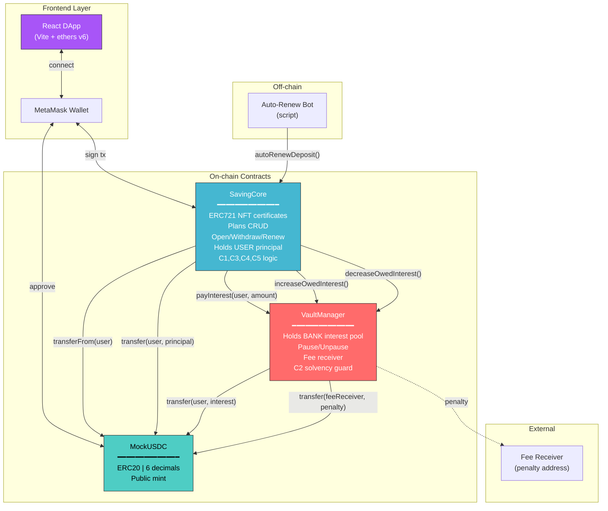
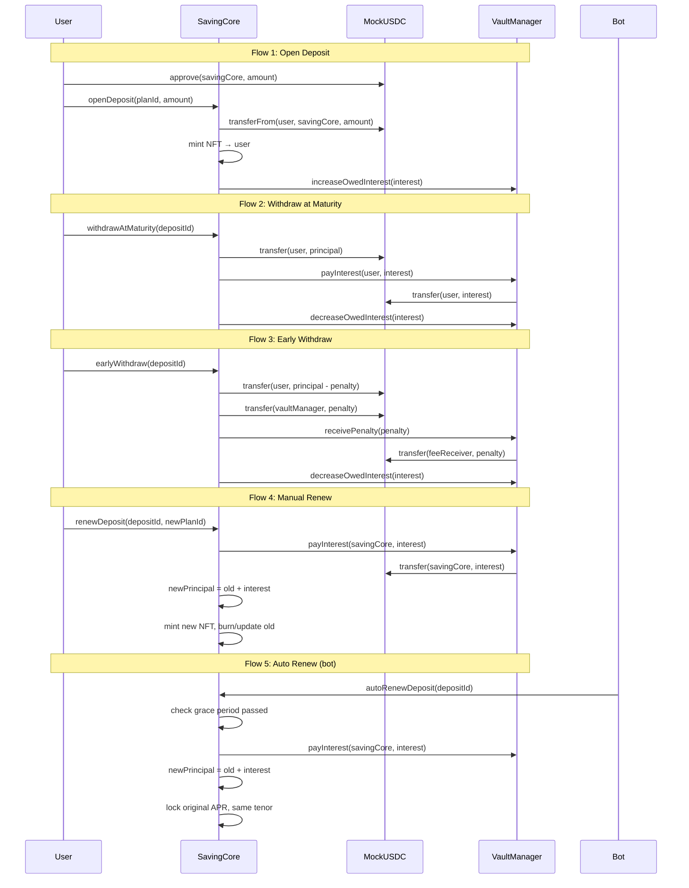
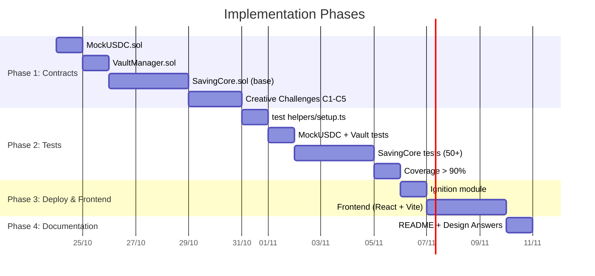

# 🏦 Bank Deposit DApp — System Design & Implementation Plan

## 1. Requirements

### 1.1 Functional Requirements

| ID | Requirement | Priority |
|---|---|---|
| FR-01 | User opens term deposit, locks tokens for fixed period | Must |
| FR-02 | User withdraws at maturity with simple interest | Must |
| FR-03 | User withdraws early with penalty, no interest | Must |
| FR-04 | User manually renews deposit into new/same plan | Must |
| FR-05 | Bot auto-renews deposit after grace period (3 days) | Must |
| FR-06 | APR & penalty snapshotted at deposit open, immutable | Must |
| FR-07 | Admin creates/updates/enables/disables saving plans | Must |
| FR-08 | Admin funds/withdraws vault (interest pool) | Must |
| FR-09 | Admin pauses/unpauses system (emergency stop) | Must |
| FR-10 | Deposit certificate as ERC721 NFT (transferable) | Must |
| FR-11 | C1: Principal always safe even when vault empty | Bonus |
| FR-12 | C2: Solvency guard blocks admin draining vault | Bonus |
| FR-13 | C3: Partial early withdrawal | Bonus |
| FR-14 | C4: Top-up existing deposit | Bonus |
| FR-15 | C5: Emergency withdraw when paused too long | Bonus |

### 1.2 Non-Functional Requirements

| Category | Requirement | Target |
|---|---|---|
| **Security** | Reentrancy protection | CEI pattern + status check |
| **Security** | Access control | Ownable (admin), NFT owner (user) |
| **Security** | Integer overflow | Solidity 0.8.28 built-in |
| **Precision** | Interest calculation | Multiply-before-divide, no truncation to zero |
| **Precision** | Token decimals | 6 decimals (USDC), NOT 18 |
| **Testability** | Code coverage | > 90% |
| **Gas** | Optimizer | Enabled, 1000 runs |
| **Separation** | Principal vs Interest | Two separate pools (SavingCore vs VaultManager) |

### 1.3 Personal Variant (Student ID: AT190234)

| Parameter | Formula | Value |
|---|---|---|
| **A** (last digit) | — | **4** |
| **B** (second-to-last) | — | **3** |
| Grace period | (4 mod 3) + 2 | **3 days = 259,200s** |
| Default APR | (200 + 4×25) bps | **300 bps = 3.00%** |
| Early penalty | (300 + 3×50) bps | **450 bps = 4.50%** |
| Default tenor | B=3 (odd) → 180 | **180 days** |

### 1.4 Constraints

- Tech stack: Hardhat v3, Solidity 0.8.28, ethers v6, TypeScript ESM
- Template: `ac-hardhat-template-v2` (already set up)
- Token: MockUSDC with 6 decimals
- Deploy: Hardhat Ignition modules
- Frontend: React + Vite + ethers v6 + MetaMask

---

## 2. High-Level Architecture



### Data Flow: Key User Flows



---

## 3. Architecture Decision Records

### ADR-001: Three-Contract Separation

**Status:** Accepted

**Context:** The system handles user money (principal) and bank money (interest pool). Mixing them creates risk — a bug in interest logic could drain user funds.

**Decision:** Split into three contracts:
- `MockUSDC` — test token
- `SavingCore` — holds user principal, all business logic, ERC721
- `VaultManager` — holds bank interest pool, admin controls, pause

**Consequences:**
- ✅ User principal isolated from interest pool bugs
- ✅ Clear separation of duties (auditable)
- ✅ Admin money controls in one place
- ❌ Cross-contract calls add gas cost (~2,100 gas per external call)
- ❌ Deploy ordering matters (SavingCore needs VaultManager address)

**Alternatives:** Single monolithic contract (rejected: mixes concerns, harder to audit)

---

### ADR-002: APR & Penalty Snapshot at Deposit Open

**Status:** Accepted

**Context:** Admin can update plan APR at any time. If deposits reference the plan directly, admin changes retroactively affect existing deposits — unfair to users who locked money at a promised rate.

**Decision:** Copy `aprBps` and `penaltyBps` into each `DepositInfo` struct at open time. These values never change, even if admin updates the plan.

**Consequences:**
- ✅ User gets the rate they agreed to — trust/fairness
- ✅ No retroactive changes possible
- ❌ Extra storage per deposit (~2 extra `uint256` slots = 40,000 gas)

**Alternatives:** Reference plan directly (rejected: unfair retroactive changes)

---

### ADR-003: Auto-Renew Locks Original APR

**Status:** Accepted

**Context:** If user doesn't act after maturity, auto-renew triggers. Should the renewed deposit use the current plan APR or the original?

**Decision:** Auto-renew preserves the original `aprBpsAtOpen`. Manual renew uses the new plan's APR.

**Consequences:**
- ✅ Protects passive users from rate decreases
- ✅ Incentivizes manual renew for rate increases
- ❌ Bank takes on rate risk if original APR was high

**Trade-off:** User protection prioritized over bank flexibility (per spec requirement).

---

### ADR-004: C1 — Principal Always Safe (Deferred Interest Pattern)

**Status:** Accepted

**Context:** Base spec says "revert if vault insufficient." This locks user's own money if bank doesn't fund vault — unfair.

**Decision:** If vault can't pay interest at maturity:
1. Pay principal immediately (from SavingCore)
2. Record `pendingInterest[user] += interest` 
3. User calls `claimPendingInterest()` later when vault is funded

**Consequences:**
- ✅ User always gets their own money back
- ✅ Interest is deferred, not lost
- ❌ Extra storage for pending interest mapping
- ❌ User must make second transaction to claim interest

**Alternatives:** 
- Pay principal only, forfeit interest (rejected: unfair)
- Queue system (rejected: over-complex)

---

### ADR-005: C2 — Solvency Guard (Owed Interest Tracking)

**Status:** Accepted

**Context:** Base spec lets admin drain vault at any time. Deposits that were payable yesterday become unpayable today.

**Decision:** Track `totalOwedInterest` in VaultManager. `withdrawVault()` enforces: `balance - amount >= totalOwedInterest`.

**Consequences:**
- ✅ Active deposits are always payable
- ✅ Simple to implement (single counter)
- ❌ Interest calculation at open time is an estimate (uses full tenor)
- ❌ Early withdrawals free up owed interest (must call `decreaseOwedInterest`)

---

## 4. Security Considerations

| Threat | Mitigation | Implementation |
|---|---|---|
| **Reentrancy** | CEI pattern (Checks-Effects-Interactions) | Set `status = Withdrawn` BEFORE external calls |
| **Double withdraw** | Status check | `require(status == Active)` |
| **Fake token** | Immutable token address | `IERC20 public immutable token` set in constructor |
| **Unauthorized access** | Ownable + NFT ownership | `onlyOwner` for admin, `ownerOf(depositId) == msg.sender` for user |
| **Integer overflow** | Solidity 0.8.28 | Built-in overflow checks |
| **Precision loss** | Multiply before divide | `(a * b * c) / d` not `(a / d) * b * c` |
| **Flash loan attack** | Token transfer before mint | User must have tokens before calling openDeposit |
| **Admin drain vault** | C2 solvency guard | `totalOwedInterest` tracking |

## 5. Failure Modes

| Failure | Impact | Mitigation |
|---|---|---|
| Vault empty at maturity | User can't withdraw | C1: Defer interest, pay principal |
| Auto-renew bot offline | Deposits stuck past grace | Users can always manually withdraw/renew |
| Admin pauses indefinitely | All funds locked | C5: Emergency withdraw after 7 days |
| Gas price spike | Transactions fail | No mitigation needed (testnet) |
| Contract upgrade needed | No proxy pattern | Accept: scope is academic project |

---

## 6. Proposed Changes (File-by-File)

### Component 1: Smart Contracts

---

#### [NEW] `contracts/MockUSDC.sol`

```solidity
// SPDX-License-Identifier: MIT
pragma solidity ^0.8.28;

import "@openzeppelin/contracts/token/ERC20/ERC20.sol";

/// @title MockUSDC - Test USDC token with 6 decimals
/// @notice Anyone can mint for testing. Mimics real USDC decimal precision.
contract MockUSDC is ERC20 {
    constructor() ERC20("Mock USDC", "USDC") {}

    /// @notice USDC uses 6 decimals, NOT 18
    function decimals() public pure override returns (uint8) {
        return 6;
    }

    /// @notice Public mint for testing
    function mint(address to, uint256 amount) external {
        _mint(to, amount);
    }
}
```

---

#### [NEW] `contracts/VaultManager.sol`

```solidity
// SPDX-License-Identifier: MIT
pragma solidity ^0.8.28;

import "@openzeppelin/contracts/token/ERC20/IERC20.sol";
import "@openzeppelin/contracts/token/ERC20/utils/SafeERC20.sol";
import "@openzeppelin/contracts/access/Ownable.sol";
import "@openzeppelin/contracts/utils/Pausable.sol";

/// @title VaultManager - Bank interest pool management
/// @notice Holds the bank's liquidity for paying interest. Separate from user principal.
/// @dev Implements C2 (Solvency Guard): tracks totalOwedInterest to prevent admin drain.
contract VaultManager is Ownable, Pausable {
    using SafeERC20 for IERC20;

    IERC20 public immutable token;
    address public feeReceiver;
    address public savingCore;
    uint256 public pausedAt;

    // C2: Solvency Guard
    uint256 public totalOwedInterest;

    event VaultFunded(address indexed funder, uint256 amount);
    event VaultWithdrawn(address indexed to, uint256 amount);
    event InterestPaid(address indexed to, uint256 amount);
    event PenaltyForwarded(address indexed from, uint256 amount, address indexed feeReceiver);
    event FeeReceiverUpdated(address indexed newFeeReceiver);
    event SavingCoreUpdated(address indexed newSavingCore);

    modifier onlySavingCore() {
        require(msg.sender == savingCore, "VM: not SavingCore");
        _;
    }

    constructor(address _token, address _feeReceiver) Ownable(msg.sender) {
        require(_token != address(0), "VM: zero token");
        require(_feeReceiver != address(0), "VM: zero feeReceiver");
        token = IERC20(_token);
        feeReceiver = _feeReceiver;
    }

    // ═══════════════════════════ Admin ═══════════════════════════

    function setSavingCore(address _sc) external onlyOwner {
        require(_sc != address(0), "VM: zero address");
        savingCore = _sc;
        emit SavingCoreUpdated(_sc);
    }

    function setFeeReceiver(address _fr) external onlyOwner {
        require(_fr != address(0), "VM: zero address");
        feeReceiver = _fr;
        emit FeeReceiverUpdated(_fr);
    }

    function fundVault(uint256 amount) external onlyOwner {
        require(amount > 0, "VM: zero amount");
        token.safeTransferFrom(msg.sender, address(this), amount);
        emit VaultFunded(msg.sender, amount);
    }

    /// @notice Admin withdraws surplus from vault
    /// @dev C2: Cannot withdraw money promised as interest
    function withdrawVault(uint256 amount) external onlyOwner {
        require(amount > 0, "VM: zero amount");
        uint256 bal = token.balanceOf(address(this));
        require(bal >= amount, "VM: insufficient balance");
        require(bal - amount >= totalOwedInterest, "VM: would be insolvent");
        token.safeTransfer(msg.sender, amount);
        emit VaultWithdrawn(msg.sender, amount);
    }

    function pause() external onlyOwner {
        _pause();
        pausedAt = block.timestamp;
    }

    function unpause() external onlyOwner {
        _unpause();
        pausedAt = 0;
    }

    // ═══════════════════════ Called by SavingCore ═══════════════════════

    function payInterest(address to, uint256 amount) external onlySavingCore {
        if (amount == 0) return;
        require(token.balanceOf(address(this)) >= amount, "VM: insufficient vault");
        token.safeTransfer(to, amount);
        emit InterestPaid(to, amount);
    }

    function receivePenalty(uint256 amount) external onlySavingCore {
        if (amount == 0) return;
        token.safeTransfer(feeReceiver, amount);
        emit PenaltyForwarded(msg.sender, amount, feeReceiver);
    }

    // C2: Solvency tracking
    function increaseOwedInterest(uint256 amount) external onlySavingCore {
        totalOwedInterest += amount;
    }

    function decreaseOwedInterest(uint256 amount) external onlySavingCore {
        totalOwedInterest = amount > totalOwedInterest ? 0 : totalOwedInterest - amount;
    }

    // ═══════════════════════════ Views ═══════════════════════════

    function getVaultBalance() external view returns (uint256) {
        return token.balanceOf(address(this));
    }

    function getAvailableBalance() external view returns (uint256) {
        uint256 bal = token.balanceOf(address(this));
        return bal > totalOwedInterest ? bal - totalOwedInterest : 0;
    }

    function isPaused() external view returns (bool) {
        return paused();
    }
}
```

---

#### [NEW] `contracts/SavingCore.sol`

Full contract with all base flows + C1–C5 creative challenges.

**Key data structures:**
```solidity
struct Plan {
    uint256 tenorDays;
    uint256 aprBps;
    uint256 minDeposit;
    uint256 maxDeposit;              // 0 = no limit
    uint256 earlyWithdrawPenaltyBps;
    bool enabled;
}

struct DepositInfo {
    uint256 planId;
    uint256 principal;
    uint256 startAt;
    uint256 maturityAt;
    uint256 aprBpsAtOpen;            // SNAPSHOT — immutable
    uint256 penaltyBpsAtOpen;        // SNAPSHOT — immutable
    uint256 tenorDays;               // stored for auto-renew same tenor
    DepositStatus status;
}

enum DepositStatus { Active, Withdrawn, ManualRenewed, AutoRenewed }
```

**Constants (personal variant):**
```solidity
uint256 public constant GRACE_PERIOD = 3 days;      // (4 mod 3) + 2 = 3
uint256 public constant BPS_DIVISOR = 10_000;
uint256 public constant YEAR_SECONDS = 365 days;     // 31,536,000
uint256 public constant EMERGENCY_DELAY = 7 days;    // C5
```

**Interest formula (precision-safe):**
```solidity
function calculateInterest(
    uint256 principal, uint256 aprBps, uint256 tenorDays
) public pure returns (uint256) {
    // Multiply before divide — preserves precision
    return (principal * aprBps * tenorDays * 1 days) / (YEAR_SECONDS * BPS_DIVISOR);
}
```

**Verification example:**
```
1,000 USDC = 1,000,000,000 units | 180 days | 300 bps
interest = (1,000,000,000 × 300 × 180 × 86,400) / (31,536,000 × 10,000)
         = 4,665,600,000,000,000,000 / 315,360,000,000
         = 14,794,520 units ≈ 14.79 USDC ✓

Penalty: 450 bps on 1,000 USDC
penalty = (1,000,000,000 × 450) / 10,000 = 45,000,000 = 45 USDC ✓
```

**Required events (from spec):**
```solidity
event PlanCreated(uint256 indexed planId, uint256 tenorDays, uint256 aprBps);
event PlanUpdated(uint256 indexed planId, uint256 newAprBps);
event DepositOpened(uint256 indexed depositId, address indexed owner,
    uint256 planId, uint256 principal, uint256 maturityAt, uint256 aprBpsAtOpen);
event Withdrawn(uint256 indexed depositId, address indexed owner,
    uint256 principal, uint256 interest, bool isEarly);
event Renewed(uint256 indexed oldDepositId, uint256 indexed newDepositId,
    uint256 newPrincipal, uint256 newPlanId);
// C1
event InterestDeferred(uint256 indexed depositId, address indexed user, uint256 amount);
event PendingInterestClaimed(address indexed user, uint256 amount);
```

**Complete function list:**

| Function | Access | Description |
|---|---|---|
| `createPlan(...)` | onlyOwner | Create saving plan |
| `updatePlan(planId, newAprBps)` | onlyOwner | Update APR (new deposits only) |
| `enablePlan(planId)` | onlyOwner | Enable plan |
| `disablePlan(planId)` | onlyOwner | Disable plan |
| `openDeposit(planId, amount)` | user | Lock tokens, mint NFT |
| `withdrawAtMaturity(depositId)` | NFT owner | Withdraw principal + interest |
| `earlyWithdraw(depositId)` | NFT owner | Withdraw with penalty, no interest |
| `renewDeposit(depositId, newPlanId)` | NFT owner | Manual renew into new plan |
| `autoRenewDeposit(depositId)` | anyone (bot) | Auto-renew after grace period |
| `claimPendingInterest()` | user | C1: Claim deferred interest |
| `partialEarlyWithdraw(depositId, amount)` | NFT owner | C3: Partial withdrawal |
| `topUpDeposit(depositId, amount)` | NFT owner | C4: Add principal |
| `emergencyWithdraw(depositId)` | NFT owner | C5: Withdraw when paused > 7 days |

**Boundary decisions (Design Question #5):**
- At exact `maturityAt` → **"at maturity"** → use `>=`
- At exact grace period end → user **can still** manually renew → use `>=`
- Auto-renew condition: `block.timestamp >= maturityAt + GRACE_PERIOD`

---

### Component 2: Test Suite

---

#### [NEW] `test/helpers/setup.ts`

Shared deployment fixture used by all test files:

```typescript
import { network } from "hardhat";

const { ethers } = await network.create();

export async function deployFixture() {
  const [owner, user1, user2, feeReceiver, bot] = await ethers.getSigners();

  // Deploy MockUSDC
  const usdc = await ethers.deployContract("MockUSDC");

  // Deploy VaultManager
  const vault = await ethers.deployContract("VaultManager", [
    await usdc.getAddress(), feeReceiver.address
  ]);

  // Deploy SavingCore
  const savingCore = await ethers.deployContract("SavingCore", [
    await usdc.getAddress(), await vault.getAddress()
  ]);

  // Link VaultManager ↔ SavingCore
  await vault.setSavingCore(await savingCore.getAddress());

  // Mint test USDC to users
  const USDC = (n: number) => BigInt(n) * 1_000_000n; // 6 decimals
  await usdc.mint(user1.address, USDC(100_000));
  await usdc.mint(user2.address, USDC(100_000));
  await usdc.mint(owner.address, USDC(1_000_000)); // for vault funding

  // Fund vault (owner approves + funds)
  await usdc.connect(owner).approve(await vault.getAddress(), USDC(500_000));
  await vault.fundVault(USDC(500_000));

  return { owner, user1, user2, feeReceiver, bot, usdc, vault, savingCore, USDC };
}

export { ethers };
```

#### [NEW] `test/MockUSDC.test.ts`

| # | Test Case |
|---|---|
| 1 | Should have name "Mock USDC" and symbol "USDC" |
| 2 | Should have 6 decimals |
| 3 | Should allow anyone to mint |
| 4 | Should transfer correctly |
| 5 | Should approve + transferFrom |

#### [NEW] `test/VaultManager.test.ts`

| # | Test Case |
|---|---|
| 1 | Should deploy with correct token and feeReceiver |
| 2 | Should revert deployment with zero addresses |
| 3 | fundVault: should accept tokens from owner |
| 4 | fundVault: should revert for non-owner |
| 5 | fundVault: should revert with zero amount |
| 6 | withdrawVault: should withdraw surplus |
| 7 | withdrawVault: should revert if insufficient balance |
| 8 | withdrawVault: should revert if would make insolvent (C2) |
| 9 | payInterest: should pay to user |
| 10 | payInterest: should revert if vault insufficient |
| 11 | payInterest: should revert if caller not SavingCore |
| 12 | pause/unpause: should toggle paused state |
| 13 | pause: should record pausedAt timestamp |
| 14 | setFeeReceiver: should update feeReceiver |
| 15 | setSavingCore: should update savingCore |

#### [NEW] `test/SavingCore.test.ts`

| # | Group | Test Case |
|---|---|---|
| 1 | createPlan | Should create plan with correct params + emit PlanCreated |
| 2 | createPlan | Should revert with APR = 0 |
| 3 | createPlan | Should revert for non-owner |
| 4 | updatePlan | Should update APR + emit PlanUpdated |
| 5 | updatePlan | Should NOT affect existing deposits (snapshot proof) |
| 6 | enable/disable | Should toggle plan enabled |
| 7 | openDeposit | Happy path: mint NFT, correct maturityAt, snapshot APR |
| 8 | openDeposit | Should emit DepositOpened with correct values |
| 9 | openDeposit | Should transfer tokens from user to contract |
| 10 | openDeposit | Should revert if plan disabled |
| 11 | openDeposit | Should revert if amount < minDeposit |
| 12 | openDeposit | Should revert if amount > maxDeposit |
| 13 | openDeposit | C2: Should increase totalOwedInterest |
| 14 | withdrawAtMaturity | Should pay correct interest (300 bps, 180 days) |
| 15 | withdrawAtMaturity | Should emit Withdrawn(isEarly=false) |
| 16 | withdrawAtMaturity | Should revert if before maturity |
| 17 | withdrawAtMaturity | Should revert if already withdrawn |
| 18 | withdrawAtMaturity | Should revert if not NFT owner |
| 19 | withdrawAtMaturity | Should revert when paused |
| 20 | withdrawAtMaturity | C1: Should defer interest if vault empty |
| 21 | withdrawAtMaturity | C2: Should decrease totalOwedInterest |
| 22 | earlyWithdraw | Should deduct penalty (450 bps = 4.5%) |
| 23 | earlyWithdraw | Should pay zero interest |
| 24 | earlyWithdraw | Should send penalty to feeReceiver |
| 25 | earlyWithdraw | Should emit Withdrawn(isEarly=true) |
| 26 | earlyWithdraw | Should revert if at/after maturity |
| 27 | earlyWithdraw | Should revert when paused |
| 28 | renewDeposit | Should compound interest into new principal |
| 29 | renewDeposit | Should use NEW plan APR |
| 30 | renewDeposit | Should mint new NFT, old status = ManualRenewed |
| 31 | renewDeposit | Should emit Renewed event |
| 32 | renewDeposit | Should revert before maturity |
| 33 | renewDeposit | Should revert if new plan disabled |
| 34 | autoRenew | Should revert before grace period (3 days) |
| 35 | autoRenew | Should succeed after grace period |
| 36 | autoRenew | Should lock ORIGINAL APR (not current) |
| 37 | autoRenew | Should keep same tenor |
| 38 | autoRenew | Should compound interest |
| 39 | autoRenew | Should emit Renewed event |
| 40 | C1 | claimPendingInterest: should pay deferred interest |
| 41 | C1 | claimPendingInterest: should revert if nothing pending |
| 42 | C3 | partialEarlyWithdraw: penalty on withdrawn amount only |
| 43 | C3 | partialEarlyWithdraw: remainder keeps earning interest |
| 44 | C3 | partialEarlyWithdraw: revert if amount >= principal |
| 45 | C4 | topUpDeposit: should add to principal correctly |
| 46 | C4 | topUpDeposit: should accrue interest on old principal |
| 47 | C5 | emergencyWithdraw: should work after 7 days paused |
| 48 | C5 | emergencyWithdraw: should return principal only |
| 49 | C5 | emergencyWithdraw: should revert if not paused |
| 50 | C5 | emergencyWithdraw: should revert if paused < 7 days |
| 51 | Edge | Double withdraw: second call reverts |
| 52 | Edge | NFT transfer: new owner can withdraw |
| 53 | Edge | Disabled plan: existing deposits can still withdraw |
| 54 | Edge | Rounding dust: does not cause revert or wrong balance |
| 55 | Edge | Boundary: at exact maturityAt is "at maturity" |

---

### Component 3: Hardhat Ignition Deploy

---

#### [NEW] `ignition/modules/BankDeposit.ts`

```typescript
import { buildModule } from "@nomicfoundation/hardhat-ignition/modules";

export default buildModule("BankDepositModule", (m) => {
  const deployer = m.getAccount(0);

  const usdc = m.contract("MockUSDC");
  const vault = m.contract("VaultManager", [usdc, deployer]);
  const savingCore = m.contract("SavingCore", [usdc, vault]);

  m.call(vault, "setSavingCore", [savingCore]);

  return { usdc, vault, savingCore };
});
```

#### [MODIFY] `package.json` scripts

```diff
-    "deploy:local": "hardhat ignition deploy ignition/modules/Counter.ts",
-    "deploy:sepolia": "hardhat ignition deploy --network sepolia ignition/modules/Counter.ts",
-    "deploy:token:local": ...
-    ... (all old scripts)
+    "compile": "hardhat compile",
+    "test": "hardhat test",
+    "coverage": "hardhat coverage",
+    "node": "hardhat node",
+    "deploy:local": "hardhat ignition deploy ignition/modules/BankDeposit.ts",
+    "deploy:sepolia": "hardhat ignition deploy --network sepolia ignition/modules/BankDeposit.ts"
```

---

### Component 4: Frontend

---

#### Design System (from ui-ux-pro-max skill)

| Property | Value |
|---|---|
| **Style** | Dark Mode (OLED) |
| **Primary Color** | `#F59E0B` (Gold — trust) |
| **Secondary** | `#FBBF24` (Light gold) |
| **CTA** | `#8B5CF6` (Purple — tech) |
| **Background** | `#0F172A` (Deep navy) |
| **Text** | `#F8FAFC` (Near white) |
| **Heading Font** | Orbitron (crypto/web3 feel) |
| **Body Font** | Exo 2 (readable, modern) |
| **Effects** | Minimal glow, dark-to-light transitions |
| **Anti-patterns** | ❌ Light backgrounds, ❌ No security indicators |

#### [NEW] `frontend/` — React + Vite + TypeScript

**Setup command:**
```bash
npx -y create-vite@latest frontend -- --template react-ts
cd frontend && npm install ethers@6
```

**Pages:**

| Page | Route | Features |
|---|---|---|
| Dashboard | `/` | Plan cards with APR, tenor, status |
| My Deposits | `/deposits` | NFT list, countdown to maturity, status badges |
| Open Deposit | `/open` | Plan selector → amount input → approve → deposit |
| Deposit Detail | `/deposit/:id` | Details + Withdraw/Renew/TopUp buttons |
| Admin | `/admin` | Create plan, fund vault, pause toggle |

**Pre-delivery checklist (from skill):**
- [ ] No emojis as icons → use Lucide React
- [ ] `cursor-pointer` on all clickable elements
- [ ] Hover transitions 150–300ms
- [ ] Focus states visible for keyboard nav
- [ ] `prefers-reduced-motion` respected
- [ ] Responsive: 375px, 768px, 1024px, 1440px

---

### Component 5: Documentation

---

#### [MODIFY] `README.md`

Structure:
```
# Bank Deposit DApp

## Personal Variant (AT190234)
## How to Run (compile, test, deploy, frontend)
## Architecture Overview (diagram)
## Design Answers (7 questions)
## Creative Challenges (C1–C5 with problem/solution/trade-off)
```

---

## 7. Execution Phases



---

## 8. Verification Plan

### Automated Tests

```bash
# Compile all contracts
npm run compile

# Run full test suite
npm test

# Run coverage report
npx hardhat coverage
# ✅ Target: > 90% line/branch coverage
```

### Manual Verification

| Check | Expected |
|---|---|
| `npm run compile` | Zero errors |
| `npm test` | All 55+ tests pass |
| `npx hardhat coverage` | > 90% coverage |
| Interest math: 1000 USDC, 180d, 300bps | ≈ 14.79 USDC |
| Penalty math: 1000 USDC, 450bps | = 45 USDC |
| Auto-renew before 3 days | Reverts |
| Auto-renew after 3 days | Succeeds, APR locked |
| Snapshot: admin changes APR → existing deposit unchanged | ✓ |
| C1: vault empty → principal still paid | ✓ |
| C2: admin tries withdraw → insolvent revert | ✓ |
| Frontend: connect MetaMask → view plans → deposit → withdraw | ✓ |
| Events: all 5 required events emitted | ✓ |
